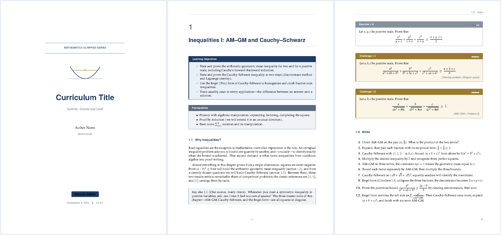

# latex-curriculum

An agent skill + LaTeX design system for producing **publication-quality
mathematics curriculum documents** — olympiad textbooks, chapter-based
teaching materials, problem sets with hints and full solutions, worked-example
handouts, and assessments. One source tree compiles to **Student** and
**Instructor** editions of a print-ready, hyperlinked PDF.



*Rendered from the bundled reference chapter "Inequalities I: AM–GM and
Cauchy–Schwarz" (includes a complete IMO 2001/2 solution).*

## Install

```bash
npx skills add will702/latex-curriculum -g
```

Works with any agent CLI that reads the agents-skills standard
(Claude Code, Codex, Cursor, Gemini CLI, ZCode, …). Or clone manually:

```bash
git clone https://github.com/will702/latex-curriculum ~/.agents/skills/latex-curriculum
```

## What you get

- **A complete design system** ("Oxford Study" palette): green definitions,
  navy theorem family with shared counters, slate exercises, gold challenge
  problems with 5-star difficulty ratings, hints, instructor-only solutions,
  crimson pitfall warnings — every box breaks cleanly across pages.
- **Professional typography**: LuaLaTeX + TeX Gyre Pagella/Pagella Math,
  microtype, A4 print geometry, running heads, hyperlinked TOC and
  `cleveref` cross-references.
- **Edition switching**: `\ifstudent` guards — `make student` drops all
  solutions and instructor notes from the same source.
- **A working reference chapter** with real olympiad content (Cauchy's
  forward–backward induction, two proofs of Cauchy–Schwarz, Engel form,
  IMO 2001 Problem 2), so every convention has a copy-paste example.
- **Automation**: `make instructor | student | chapter C=N | check | preview`,
  scaffolding (`init-curriculum.sh`), chapter generation (`add-chapter.sh`),
  and a QA gate (`qa-check.sh`: errors, undefined refs/citations, missing
  glyphs, overfull boxes, PDF validity).

## Quick start

```bash
# Scaffold a new curriculum from the skill's bundled template
SKILL_DIR/templates/curriculum-template/scripts/init-curriculum.sh \
    ~/courses/number-theory "Number Theory I" "Jane Doe"

cd ~/courses/number-theory
make instructor   # → output/instructor.pdf (theory + problems + hints + solutions)
make student      # → output/student.pdf    (problems + hints only)
make check        # QA gate
```

## Requirements

macOS with [MacTeX](https://www.tug.org/mactex/) (Basic suffices) plus
user-mode packages (no sudo):

```bash
tlmgr init-usertree    # once
tlmgr --usermode install tcolorbox thmtools enumitem cleveref \
    titlesec pgfplots tex-gyre tex-gyre-math lualatex-math tikzfill pdfcol
mktexlsr ~/Library/texmf    # tlmgr's mktexlsr skips the user tree

# latexmk (single Perl file; no Homebrew formula exists)
curl -fsSL -o ~/.local/bin/latexmk https://mirrors.ctan.org/support/latexmk/latexmk.pl
chmod +x ~/.local/bin/latexmk
```

Linux/TeX Live full installs already contain everything. See
`SKILL.md` for the full environment guide, authoring conventions, and a
troubleshooting matrix.

## Repository layout

```
├── SKILL.md              # the agent skill entrypoint (conventions, QA, troubleshooting)
├── templates/curriculum-template/
│   ├── main.tex, student.tex, instructor.tex, latexmkrc, Makefile, README.md
│   ├── config/           # colors, typography, layout, commands, environments
│   ├── components/       # cover, frontmatter, chapter summary
│   ├── chapters/         # reference chapter (AM–GM & Cauchy–Schwarz)
│   ├── exercises/        # problems / hints / solutions
│   ├── references/       # bibliography
│   └── scripts/          # init-curriculum.sh, add-chapter.sh, qa-check.sh
└── assets/preview.png
```

## Notes

- The demo chapter's mathematics (including the IMO 2001 Problem 2 writeup)
  is original exposition; competition problems are restated for teaching.
- nicematrix is intentionally unsupported (frozen BasicTeX kernels predate
  its requirements); `booktabs` + amsmath matrices cover curriculum needs.

## License

MIT — see [LICENSE](LICENSE).
